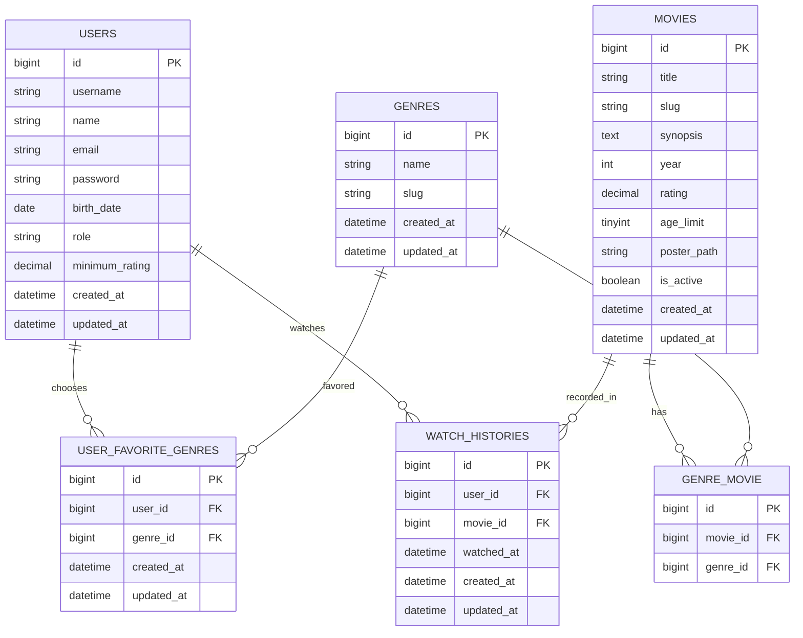
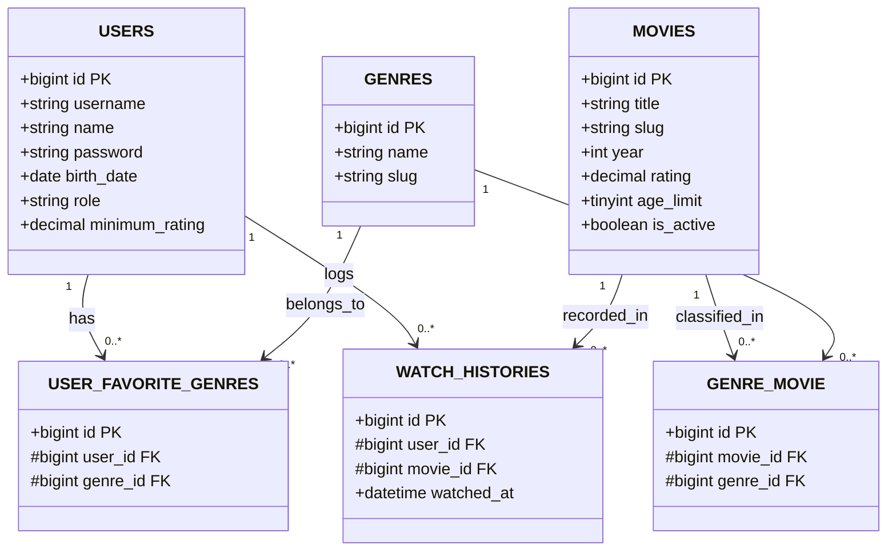
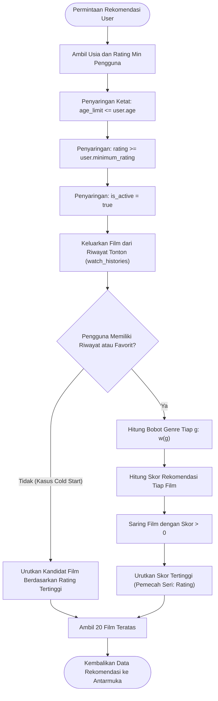
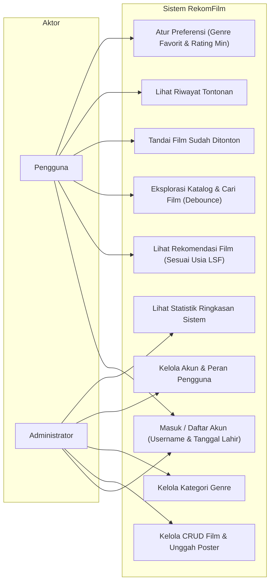
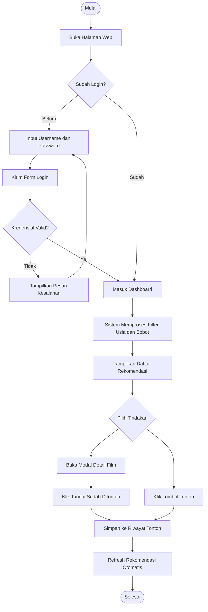
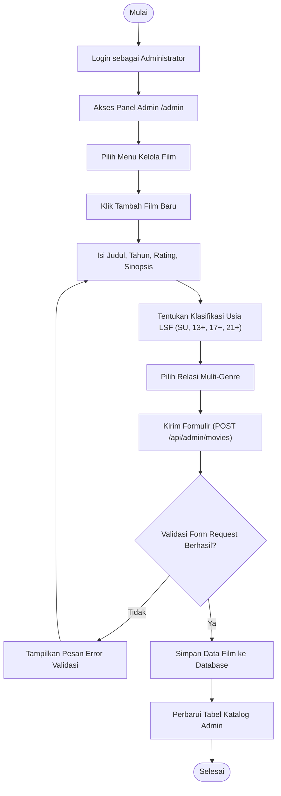

# Dokumentasi Arsitektur & Perancangan Sistem RekomFilm

Dokumen ini memuat spesifikasi teknis lengkap, pemodelan data (ERD & LRS), diagram alur kerja (Flowchart), Use Case, dan Activity Diagram untuk sistem rekomendasi film berbasis **Laravel 11**.

---

## 1. Versi & Spesifikasi Teknologi

| Komponen | Spesifikasi / Versi | Detail Teknis |
|---|---|---|
| **Versi Rilis Aplikasi** | v1.0.0 (Rilis Awal) | Semantic versioning |
| **Bahasa Pemrograman** | PHP >= 8.2 s.d. 8.4+ | Teruji di PHP 8.3 bawaan Laragon, kompatibel PHP 8.2 dan 8.4+ |
| **Framework Web** | Laravel 11.57.0 | Pola MVC, Service Layer, Form Request, Sanctum |
| **Basis Data** | MySQL 8.0.30 / MariaDB | Relasi cascadeOnDelete, indeks majemuk usia & rating |
| **Autentikasi** | Session Web & Sanctum Token | Kredensial berbasis `username` unik dan password ter-hash |
| **Desain Antarmuka** | Vanilla CSS (Gaya shadcn/ui) | Tema gelap netral zinc, radius sedang, border halus |
| **JavaScript** | Vanilla JS + jQuery 3.7.1 | Manipulasi DOM, debounce pencarian, interaksi modal |
| **Ikonografi** | Ikon Vektor SVG (Lucide) | Murni berkas/vektor SVG, tanpa emotikon |
| **PWA (Progressive Web App)** | Manifest & Service Worker | Cache-first aset statis, pengabaian cache API personal |

---

## 2. Entity Relationship Diagram (ERD)

Diagram pemodelan basis data konseptual dan relasi kardinalitas antar entitas:

---

## 3. Logical Record Structure (LRS)

Representasi struktur logis antar tabel relasional beserta atribut kunci primer (PK) dan kunci tamu (FK):

---

## 4. Flowchart Logika Rekomendasi & Filter Usia LSF

Alur kerja evaluasi dan pembobotan film pada `RecommendationService`:

---

## 5. Use Case Diagram

Interaksi antara Aktor (**Pengguna** dan **Administrator**) terhadap kapabilitas sistem:

---

## 6. Activity Diagram

### 6.1 Aktivitas Pengguna: Eksplorasi, Tonton, dan Pembaruan Rekomendasi

### 6.2 Aktivitas Administrator: Mengelola Data Film & Batas Usia LSF

