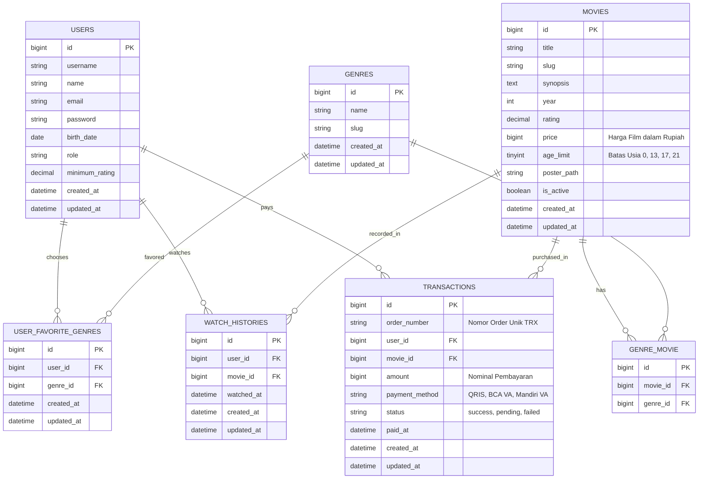
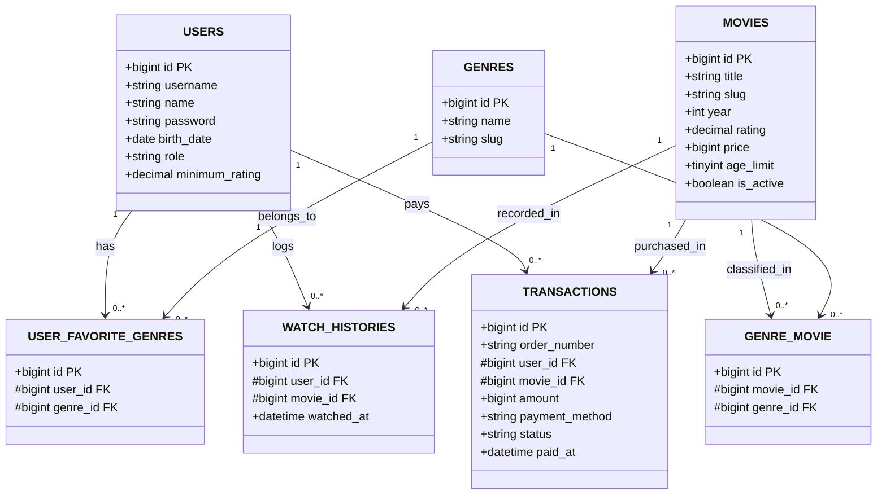
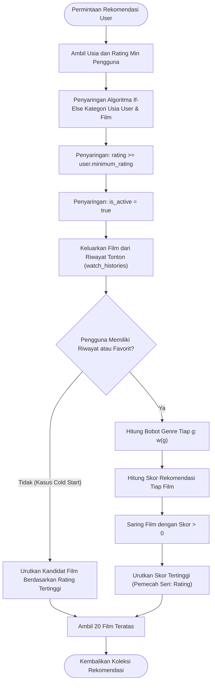
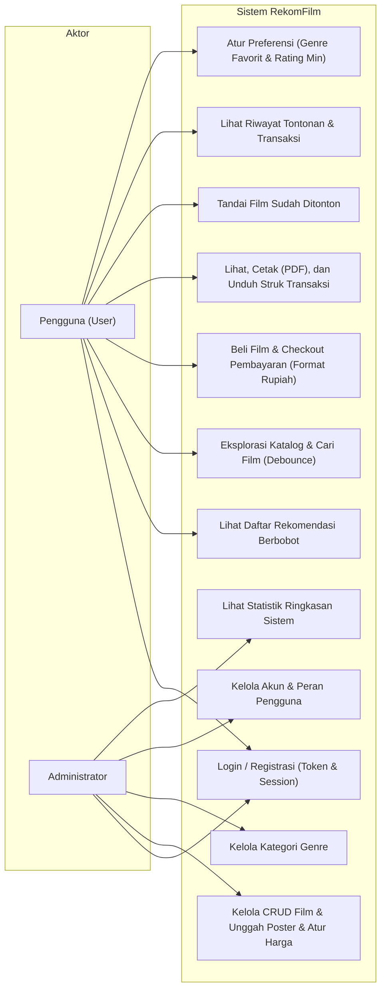
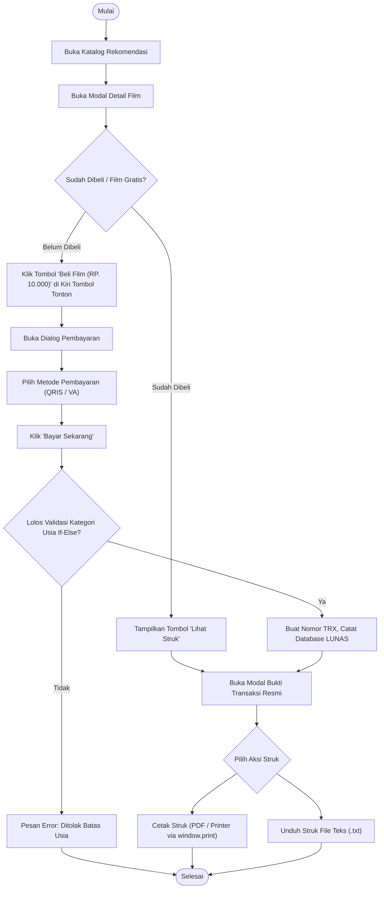

# Dokumentasi Arsitektur & Perancangan Sistem RekomFilm

Dokumen ini memuat spesifikasi teknis lengkap, pemodelan data (ERD & LRS), diagram alur kerja (Flowchart), Use Case, Activity Diagram, serta **Catatan Pembaruan (Changelog)** untuk sistem rekomendasi film berbasis **Laravel 11**.

---

## 1. Versi & Spesifikasi Teknologi

| Komponen | Spesifikasi / Versi | Detail Teknis |
|---|---|---|
| **Versi Rilis Aplikasi** | v1.1.0 (Pembaruan Pembayaran & Limitasi Umur) | Semantic versioning |
| **Bahasa Pemrograman** | PHP >= 8.2 s.d. 8.4+ | Teruji di PHP 8.3 bawaan Laragon, kompatibel PHP 8.2 dan 8.4+ |
| **Framework Web** | Laravel 11.57.0 | Pola MVC, Service Layer, Form Request, Sanctum |
| **Basis Data** | MySQL 8.0.30 / MariaDB | Relasi cascadeOnDelete, indeks majemuk usia, rating & transaksi |
| **Autentikasi** | Session Web & Sanctum Token | Kredensial berbasis `username` unik dan password ter-hash |
| **Desain Antarmuka** | Vanilla CSS (Gaya shadcn/ui) | Tema gelap netral zinc, radius sedang, cetak struk via `@media print` |
| **JavaScript** | Vanilla JS + jQuery 3.7.1 | Manipulasi DOM, format nominal Rupiah otomatis, print & download struk |
| **Ikonografi** | Ikon Vektor SVG (Lucide) | Murni berkas/vektor SVG, tanpa emotikon |
| **Kesiapan Mobile** | RESTful JSON API (29 Endpoints) | Siap diintegrasikan dengan aplikasi mobile Android & iOS |

---

## 2. Entity Relationship Diagram (ERD)

Diagram pemodelan basis data konseptual dan relasi kardinalitas antar entitas:



---

## 3. Logical Record Structure (LRS)

Representasi struktur logis antar tabel relasional beserta atribut kunci primer (PK) dan kunci tamu (FK):



---

## 4. Flowchart Logika Rekomendasi & Filter Usia LSF

Alur kerja evaluasi dan pembobotan film pada `RecommendationService`:



---

## 5. Use Case Diagram

Interaksi peran **Pengguna (User)** dan **Administrator (Admin)** terhadap fungsionalitas sistem:



---

## 6. Activity Diagram

### 6.1 Aktivitas Pengguna: Eksplorasi, Pembelian, dan Cetak Struk



---

## 7. Catatan Pembaruan & Riwayat Perubahan (Changelog Pembaruan v1.1.0)

Berikut adalah rekapitulasi detail seluruh penambahan fitur dan pembaruan arsitektur sistem pada rilis **v1.1.0**:

### 🎯 Pembaruan 1: Penghapusan Span Badge Umur di Header Navigasi Kanan Atas
- **File Terdampak**: [resources/views/layouts/app.blade.php](file:///c:/laragon/www/rekomendasi-film/resources/views/layouts/app.blade.php)
- **Keterangan**:
  - Elemen badge umur (`<span class="badge badge-13">{{ auth()->user()->age }} Tahun</span>`) yang sebelumnya berada di sudut kanan atas sebelah kiri nama akun pengguna/admin telah **dihapus**.
  - Area navbar kanan atas kini lebih bersih dan konsisten, hanya menampilkan nama akun serta tombol *logout*.

---

### 💰 Pembaruan 2: Modul Pembayaran Film & Format Nominal Rupiah
- **File Terdampak**:
  - [database/migrations/2026_10_21_132901_add_price_to_movies_table.php](file:///c:/laragon/www/rekomendasi-film/database/migrations/2026_10_21_132901_add_price_to_movies_table.php)
  - [app/Models/Movie.php](file:///c:/laragon/www/rekomendasi-film/app/Models/Movie.php)
  - [app/Http/Requests/MovieRequest.php](file:///c:/laragon/www/rekomendasi-film/app/Http/Requests/MovieRequest.php)
  - [resources/views/admin/movies.blade.php](file:///c:/laragon/www/rekomendasi-film/resources/views/admin/movies.blade.php)
  - [resources/views/user/dashboard.blade.php](file:///c:/laragon/www/rekomendasi-film/resources/views/user/dashboard.blade.php)
- **Keterangan**:
  1. **Kolom Harga Basis Data**: Menambahkan kolom `price` (`unsignedBigInteger`, default: `0`) pada tabel `movies`.
  2. **Format Penulisan Rupiah dengan Titik**:
     - Standar format harga menggunakan awalan `RP. ` dan pemisah ribuan titik (`.`), contoh: `RP. 10.000` (bukan digabung `RP. 10000`).
     - Diimplementasikan melalui aksesor model `formatted_price` di `Movie.php`.
  3. **Manajemen di Back Office / Admin Panel**:
     - Menambahkan kolom **Harga Film** pada tabel daftar film admin.
     - Menambahkan input **Harga Film (Rupiah)** pada formulir tambah & edit film.
     - Dilengkapi *auto-formatting* berbasis JavaScript yang otomatis menyisipkan titik saat admin mengetik angka nominal (contoh: mengetik `25000` otomatis terformat menjadi `25.000`).
  4. **Tata Letak Tombol Pembelian di Detail Film**:
     - Tombol **Beli Film (`RP. 10.000`)** diletakkan di bagian detail film, tepat di sebelah **KIRI** tombol **"Tandai Sudah Ditonton"**.
     - Diberikan jarak renggang (*spacing*) yang jelas (`gap: 1rem`) dari tombol "Tandai Sudah Ditonton" agar nyaman diakses pengguna.

---

### 🛡️ Pembaruan 3: Klasifikasi Kategori Umur Menggunakan Algoritma If-Else
- **File Terdampak**:
  - [app/Models/User.php](file:///c:/laragon/www/rekomendasi-film/app/Models/User.php) (`getAgeCategoryAttribute`)
  - [app/Models/Movie.php](file:///c:/laragon/www/rekomendasi-film/app/Models/Movie.php) (`getAgeCategoryAttribute`, `scopeForAge`)
  - [app/Http/Controllers/Api/MovieController.php](file:///c:/laragon/www/rekomendasi-film/app/Http/Controllers/Api/MovieController.php) (`evaluateAgeAccess`)
  - [resources/views/user/dashboard.blade.php](file:///c:/laragon/www/rekomendasi-film/resources/views/user/dashboard.blade.php)
  - [resources/views/user/history.blade.php](file:///c:/laragon/www/rekomendasi-film/resources/views/user/history.blade.php)
  - [resources/views/admin/movies.blade.php](file:///c:/laragon/www/rekomendasi-film/resources/views/admin/movies.blade.php)
- **Keterangan**:
  Struktur algoritma *if-else* diterapkan secara tegas untuk mengkategorikan batas umur pengguna maupun film ke dalam 3 kelompok utama:
  
  ```php
  // Algoritma if-else klasifikasi umur:
  if ($age < 13) {
      $category = 'Di Bawah Umur'; // Hanya boleh film Di Bawah Umur (SU)
  } elseif ($age < 18) {
      $category = 'Remaja';        // Boleh film Di Bawah Umur dan Remaja (13+)
  } else {
      $category = 'Dewasa';        // Boleh semua kategori (SU, 13+, 17+, 21+)
  }
  ```
  - **Validasi Akses**: Pengguna yang berstatus *Di Bawah Umur* dicegah secara sistemik untuk menonton, membuka detail, maupun membeli film kategori *Remaja* atau *Dewasa* (HTTP 403 Forbidden).
  - **Tampilan UI**: Kartu film dan dashboard menampilkan teks kategori yang mudah dipahami: `Di Bawah Umur (SU)`, `Remaja (13+)`, dan `Dewasa (18+/21+)`.

---

### 🧾 Pembaruan 4: Bukti Transaksi Resmi (Struk yang Dapat Dicetak & Didownload)
- **File Terdampak**:
  - [database/migrations/2026_10_21_132908_create_transactions_table.php](file:///c:/laragon/www/rekomendasi-film/database/migrations/2026_10_21_132908_create_transactions_table.php)
  - [app/Models/Transaction.php](file:///c:/laragon/www/rekomendasi-film/app/Models/Transaction.php)
  - [app/Http/Controllers/Api/TransactionController.php](file:///c:/laragon/www/rekomendasi-film/app/Http/Controllers/Api/TransactionController.php)
  - [resources/views/user/transactions.blade.php](file:///c:/laragon/www/rekomendasi-film/resources/views/user/transactions.blade.php)
  - [resources/views/layouts/app.blade.php](file:///c:/laragon/www/rekomendasi-film/resources/views/layouts/app.blade.php)
  - [public/css/app.css](file:///c:/laragon/www/rekomendasi-film/public/css/app.css)
- **Keterangan**:
  1. **Tabel Basis Data `transactions`**:
     - Menyimpan `order_number` unik (misal: `TRX-20261021-XXXX`), `user_id`, `movie_id`, `amount`, `payment_method` (QRIS, BCA VA, Mandiri VA), `status` (`success`), dan `paid_at`.
  2. **Tampilan Struk Transaksi Resmi**:
     - Didesain menyerupai struk pembayaran digital profesional dengan detail No. Transaksi, Tanggal & Jam, Identitas Akun, Judul Film, Kategori Usia, Metode Pembayaran, Stempel `LUNAS / BERHASIL`, dan Total Bayar.
  3. **Fitur Cetak Struk (PDF / Printer)**:
     - Dilengkapi tombol **Cetak Struk (PDF)** menggunakan `window.print()`.
     - Styling khusus `@media print` diterapkan pada `app.css` untuk otomatis menyembunyikan navigasi, tombol, dan background website gelap sehingga hasil cetakan/PDF berlatar putih bersih dengan tipografi tajam.
  4. **Fitur Download Struk (Berkas Teks)**:
     - Dilengkapi tombol **Download Struk (Teks)** yang langsung menghasilkan dan mengunduh berkas `Struk-[NoOrder].txt` ke perangkat pengguna secara instan tanpa reload halaman.
  5. **Halaman Menu Riwayat Transaksi (`/transactions`)**:
     - Menambahkan menu **Transaksi** pada navigasi utama akun pengguna.
     - Pengguna dapat melihat daftar seluruh riwayat pembelian film yang pernah dilakukan dan membuka kembali struk pembayaran untuk dicetak/didownload kapan saja.

---

### 📱 Pembaruan 5: Kesiapan REST API untuk Aplikasi Mobile (Android & iOS)
- **File Terdampak**:
  - [routes/api.php](file:///c:/laragon/www/rekomendasi-film/routes/api.php)
- **Keterangan**:
  - Seluruh endpoint API kini berjumlah **29 routes** aktif dengan dukungan autentikasi Bearer Token (Laravel Sanctum).
  - Penambahan endpoint mobile baru:
    - `POST /api/movies/{id}/purchase` : Beli film dan terbitkan struk transaksi dari perangkat mobile.
    - `GET /api/me/transactions` : Mengambil daftar histori transaksi akun pengguna di mobile.
    - `GET /api/transactions/{identifier}` : Mengambil data struk spesifik berdasarkan nomor order / ID.
